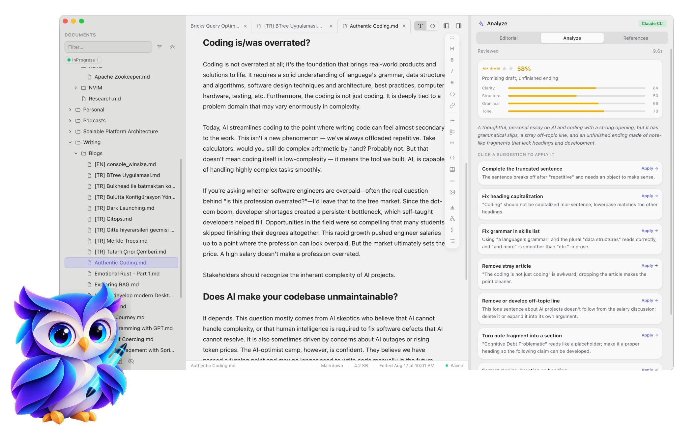
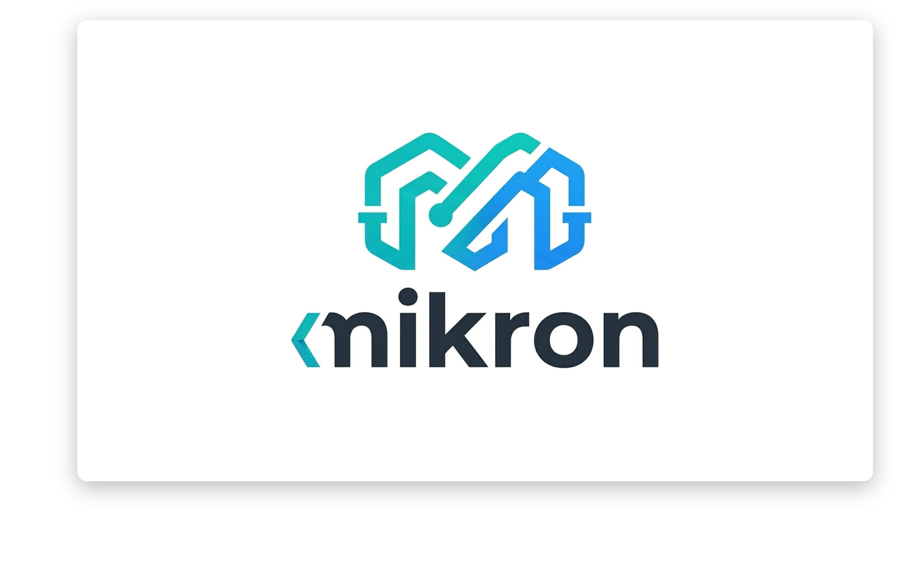
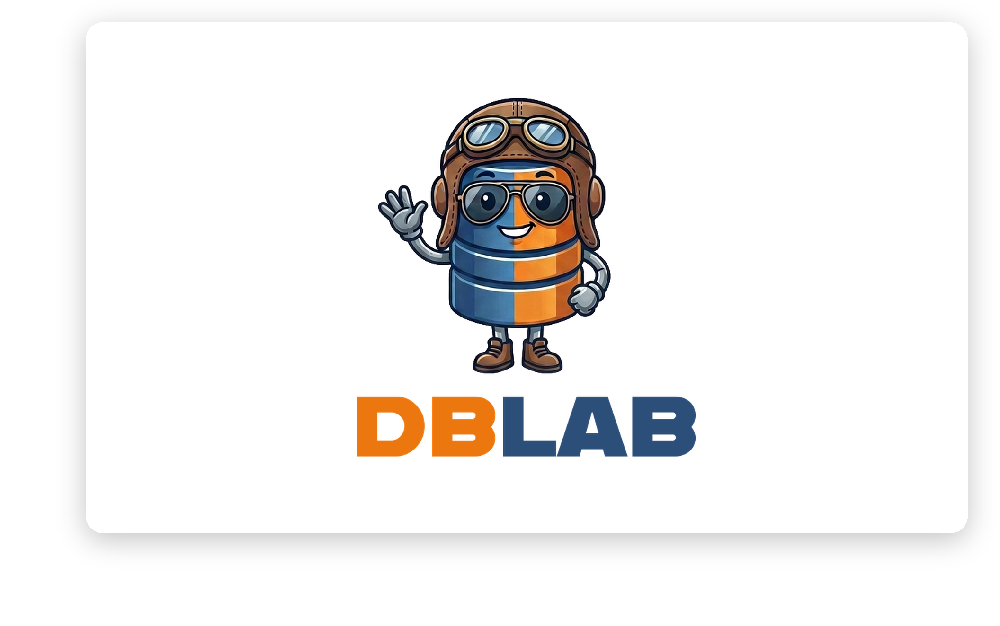

# Hey, I am Erhan 👋

📍 **Hamburg ↔ Izmir** | 🤖 **From Enterprise Backends to Agentic** | 🚀 **Reevik.net**

> I am an Engineer, a passionate Photographer, and Dad. On Github, you will find some of my side projects. I am always interested in emerging technologies and software excellence. Feel free to connect me. 

     

 

## What I'm Doing Here

- **Codesmith** - Learning and building tools.
- **Rapid prototyping** - Full apps in days, not months

## Projects

<table>
  <tr>
    <td width="50%" align="center" valign="top">
      
       
      <b><a href="https://github.com/reevik/reevik-markdown-app">Reevik</a></b>
       
      An agentic Markdown editor for macOS — Live Preview with charts, diagrams and math, Obsidian-style vaults, and an AI writing agent (Claude or GitHub Copilot) that edits your notes with you. <a href="https://github.com/reevik/reevik-markdown-app/releases/latest">Download →</a>
    </td>
    <td width="50%" align="center" valign="top">
      
       
      <b><a href="https://github.com/reevik/mikron">Mikron</a></b>
       
      A minimalistic, web-free IoC container for Java — dependency injection and externalized configuration management.
    </td>
  </tr>
  <tr>
    <td width="50%" align="center" valign="top">
      
       
      <b><a href="https://github.com/reevik/db-lab">dblab</a></b>
       
      An experimental, educational B+Tree based NoSQL database written in Rust — slotted pages, page splits and merges, with a write-ahead log, sharding and consensus on the roadmap.
    </td>
    <td width="50%"></td>
  </tr>
</table>
